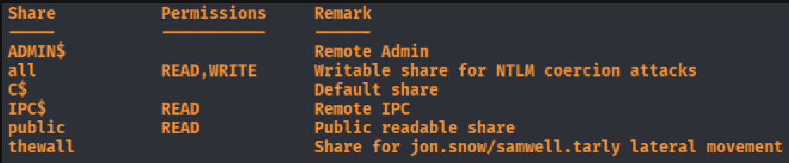
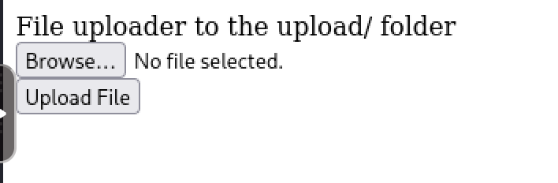
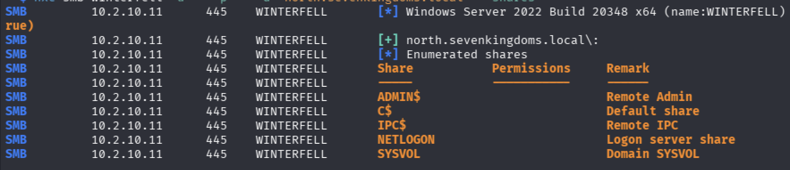
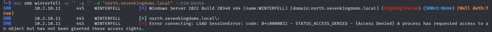
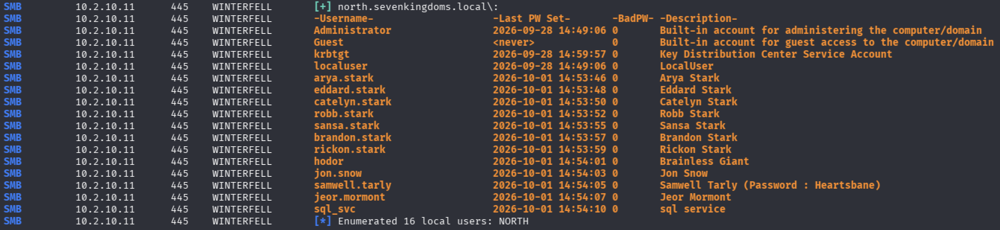

The first thing I did is nmap the whole IP range.

```bash
  nmap 10.2.10.0/24 -sC -sV -T4 -Ao nmap
```

### We have 5 machines on the network:

- sevenkingdoms.local
  - Kingslanding - 10.2.10.10
  - north
    - Winterfell - 10.2.10.11
    - Castleblack - 10.2.10.12
     
- essos.local
  - Meereen - 10.2.10.13
  - Braavos - 10.2.10.14

---

In the Castleblack machine, we can see an smb auth with the `Guest` user.


We get two user from the last share remark: `jon.snow` and `samwell.tarly`. 
> [!NOTE]
> Nothing was found in the shares.

There is also a 80 port with IIS running. And there is an upload page. I think we can maybe get a shell with this but we will get to it later.



> [!NOTE]
> I tried to enumerate RIDs with the Castleblack machine but it was not relevant.


In the Winterfell machine we can enumarate SMB shares with anonymous auth.


And here it is blocked with anonymous and Guest.

The `--users` is a better option than `--rid-brute` when the anonymous auth is enabled. 

```bash
  nxc smb winterfell -u '' -p '' \
    -d "north.sevenkingdoms.local" --users
```
 

Now we get a lot of users, we don't know if there are more. We see a password for `samwell.tarly`.

> [!TIP]
> With the password we can now try LDAP, WinRM or SMB.

