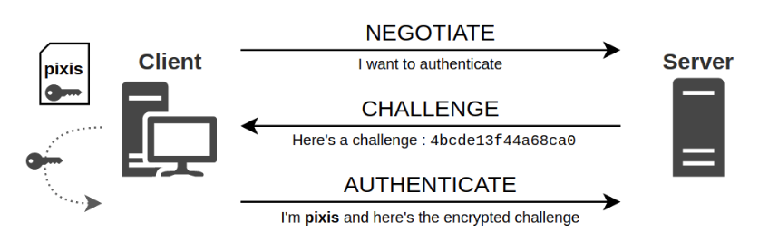
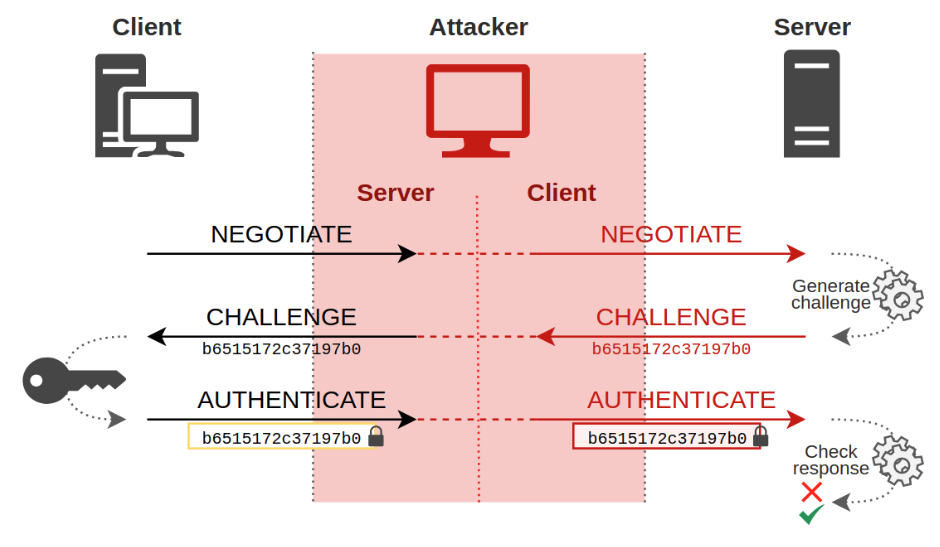
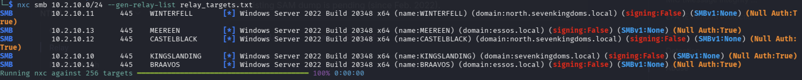
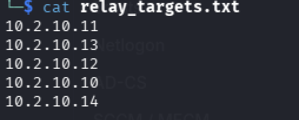

# This page is dedicated to NTML Relay attack

> [!NOTE]
> Don't worry I will explain in details what is NTLM Relay attack

There are many different NTLM relay attacks, we are going to focus on the most basic one. So If a user search for an SMB share that does not exist, the machine is going to ask the DNS for the machine IP, but as it doest exist the DNS does not know the answer. So it passes it to the LLMR protocol, which will broadcast a message like "Who is ..." with the NTLM challenge to authenticate. We can then relay the challenge and send it to another machine. At least in theory.

To perform the attack we need to understand how the authentication works
  
So the client ask the server for info about its version over SMB for instance, if it's signed or which hashing algorithm it uses (e.g NTLMv1, NTLMv2). The picture you see above describe the `NTLM Handshake` and can be used over SMB, HTTP, LDAP, RPC and more. 

In order to authenticate, each part is calculating the session key with the challenge, the NTHash of the client and the combination of both. Then, the client sends the response to the server to prove its identity. A part from the challenge and the response nothing else is sent over the network. 

> [!NOTE]
> How does the server compute the session key without the NTHash of the client ? It sends the challenge and the client response to the DC and the DC verifies the proof and then sends back the session key. But only to the target server not the attacker.

## The attack

So we want to be in the server shoes to get the response of the victim. But we also want to be in the client shoes to get the challenge from the target server. We then proxy the challenge to the victim and get the response. And boom we are in the session (TCP session), so the client thinks we are a legitimate server and the server thinks we are the client. We can now send any request over the protocol we used as the user we trapped.

  

> [!WARNING]
> If the `signing:True` appears we cannot use this attack. With the signing enabled, the packets in the session are signed with the session key the attacker doesn't have. So the session is successfully created but shutdown immediately because the packets are not signed.
 
## How to identify candidates machine for the attack
  
Here we see that every machine are vulnerable. We can also generate a list with nxc.

So here are the machines against we are going to test the attack.

I tried running responder to see if there bots configured to missmatch an smb share. But nothing happened. So we need a way to force a client into sending false SMB share request.

To force a client into sending an SMB share request to us we can perform a Coercion Attack.
First we need to identify who is vulnerable to it. Then choose how we want to do the attack.

## What is a Coercion Attack ?

I will explain.

do